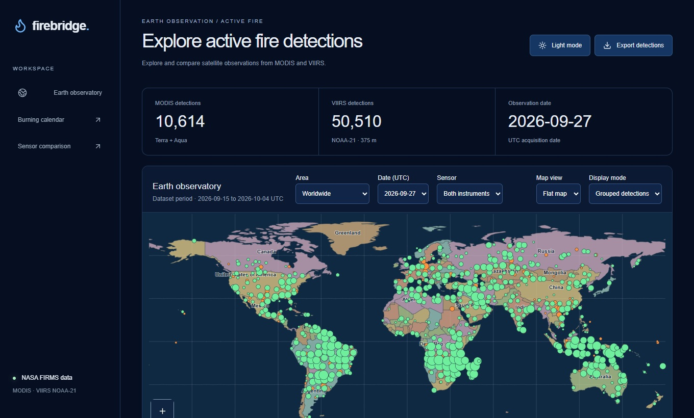
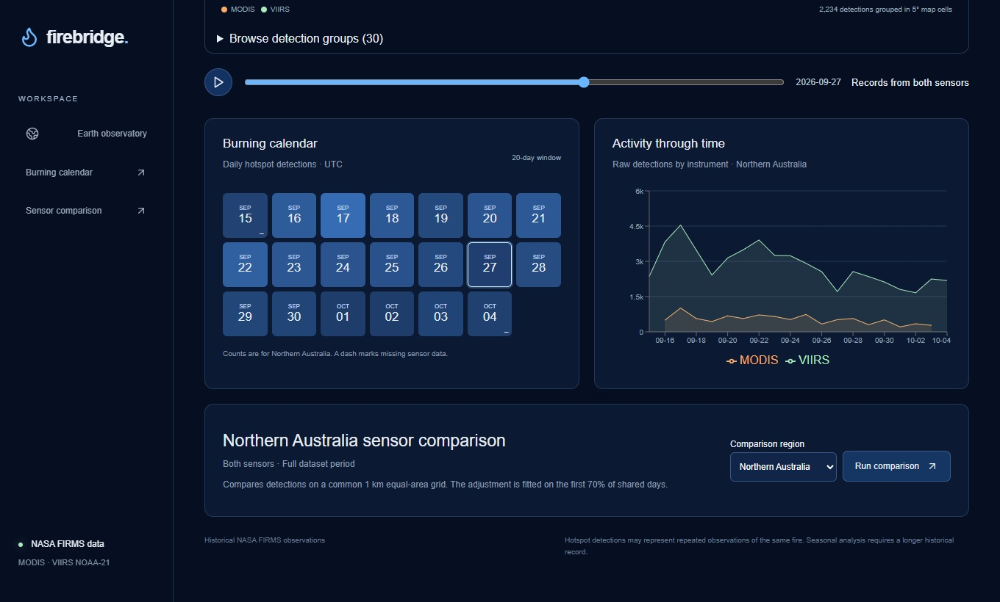
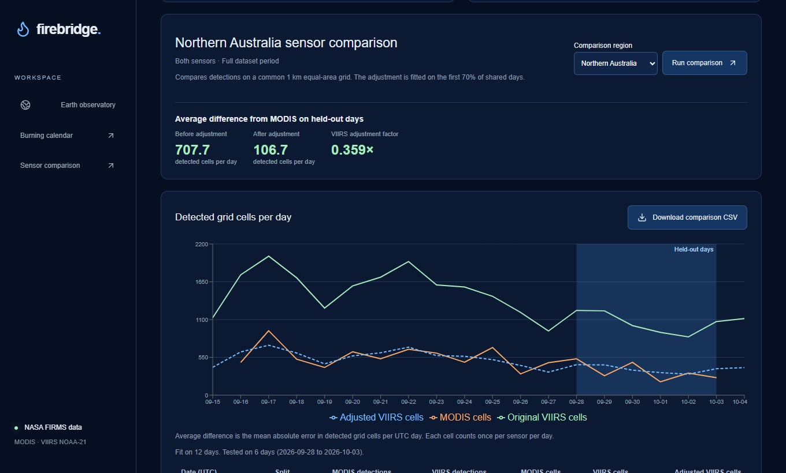

# FireBridge

FireBridge is a NASA Space Apps Challenge project by **Tharaka Prabash** (solo participant). It brings NASA FIRMS active-fire observations from MODIS and VIIRS into one dashboard for exploring where detections occurred, how activity changed across UTC dates, and how daily counts compare on a common grid.



## Features

- **Earth Observatory** — Explore a 3D globe or a flat map. Filter by area, UTC date, and instrument. Switch between detection groups and individual hotspots, or drill down from a group into its observations.
- **Hotspot details** — Inspect the satellite, UTC acquisition time, coordinates, source confidence, and fire radiative power when available.
- **Burning Calendar** — Select dates directly or play through the timeline. Compare raw daily detections by instrument in the activity chart.
- **Sensor comparison** — Compare daily counts on a shared 1 km equal-area grid. Review the original and adjusted VIIRS series alongside MODIS, including mean absolute error on held-out days when an adjustment can be fitted.
- **CSV export** — Download detections for the selected date and filters, or for an inspected group. Download the comparison table from the dashboard and daily raw counts from the API.

## Screenshots

### Burning Calendar and activity chart



### Northern Australia sensor comparison



The screenshots use a September 15 to October 4, 2026 UTC snapshot with Terra and Aqua MODIS and NOAA-21 VIIRS. The Northern Australia example fits an adjustment on 12 paired days and evaluates it on six. Its held-out mean absolute error changes from 707.7 to 106.7 detected cells per day for that snapshot and region.

## Run locally

### 1. Clone the repository

Install Python 3.10+ and Node.js with npm. Node.js 22 is a suitable choice for the Vite frontend.

```sh
git clone https://github.com/thrakaprabash/firebridge-nasa-harmonization-of-MODIS-and-VIIRS-hot-spots.git
cd firebridge-nasa-harmonization-of-MODIS-and-VIIRS-hot-spots
```

### 2. Add NASA FIRMS data

Download active-fire files for MODIS and VIIRS over overlapping dates. Use comma-separated text with the original FIRMS header row. Extract any downloaded archives, then put the MODIS files in `Modis/` and the VIIRS files in `VIIRS/` at the repository root. The importer reads `*.txt` directly from those folders. For downloads with a `.csv` extension, rename the extracted files to `.txt` without changing their contents.

Required columns are `latitude`, `longitude`, `acq_date`, `acq_time`, `satellite`, `confidence`, `version`, `daynight`, and `frp`. Keep at least one file in each folder. For the comparison, choose a region with detections and a date range with at least 10 days of records from both instruments.

Sources — [NASA FIRMS active fire data](https://firms.modaps.eosdis.nasa.gov/content/active_fire/) · [FIRMS archive download](https://firms2.modaps.eosdis.nasa.gov/download/)

### 3. Build the database and start Flask

From the repository root, run the following commands. The importer creates `hotspots.sqlite`, deduplicates repeated input records, and prints the observation counts and shared dates. Run it again after replacing or adding input files.

```sh
python -m pip install -r requirements.txt
python ingest.py
python -m flask --app app run
```

Open [the API health endpoint](http://127.0.0.1:5000/api/health) and confirm it returns `{"status":"ok"}`. If it returns HTTP 503, check that ingestion succeeded and produced a populated `hotspots.sqlite` beside `app.py`.

### 4. Start the dashboard

In a second terminal, from the repository root:

```sh
cd frontend
npm ci
npm run dev
```

Open [FireBridge on port 5173](http://127.0.0.1:5173). Vite proxies `/api` to Flask on port 5000. The globe textures and flat-map country boundaries load from external hosts.

From `frontend/`, run `npm run build` to generate static assets in `frontend/dist/`. A deployment needs to serve those assets and route `/api` to the Flask backend with an ingested database.

## How the comparison works

1. Project detection coordinates into a cylindrical equal-area grid with 1 km cells. Count each occupied cell once per instrument per UTC day, pooling satellites within each instrument.
2. Identify dates with records from both instruments. With at least 10 paired dates and positive totals for both instruments in the training period, fit a multiplier using the chronological first 70% of paired dates. The multiplier is the total MODIS cell count divided by the total VIIRS cell count over those dates.
3. Apply the multiplier to VIIRS counts. On the remaining paired dates, compute mean absolute error against MODIS before and after adjustment. MODIS serves as the comparison reference.

A missing count means the local dataset has no records for that instrument on that UTC date. A zero means records exist for the instrument on that date, with zero detections matching the selected area. Hotspot records can include repeated observations of a fire, and the counts describe detections within the source dataset. The adjustment is experimental and depends on the selected region and dates. Seasonal analysis requires multi-year data.

## API

| GET endpoint | Returns |
| --- | --- |
| `/api/health` | Database readiness |
| `/api/coverage` | Record coverage by satellite and dates with both instruments |
| `/api/daily` | Daily raw detections by instrument |
| `/api/map-clusters` | Five-degree map groups for one UTC date |
| `/api/hotspots` | Paginated GeoJSON hotspot observations |
| `/api/comparison` | Daily grid counts, adjustment factor, and validation metrics |
| `/api/export` | Hotspot or daily-count CSV |

See [API.md](API.md) for query parameters, pagination, and response details.

## Project structure

| Path | Purpose |
| --- | --- |
| `ingest.py` | Imports FIRMS files into SQLite |
| `app.py` | Flask API for filtering, grouping, comparison, and export |
| `frontend/` | React and Vite dashboard with React Globe.gl, D3 Geo, and Recharts |
| `docs/screenshots/` | Dashboard screenshots |

NASA FIRMS provides the active-fire observations. Natural Earth provides the flat-map country boundaries.

